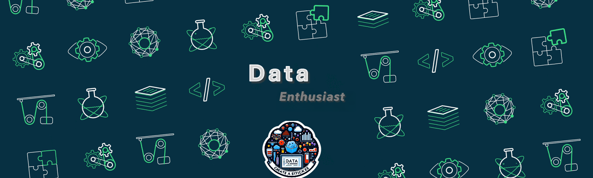

<!-- Add a header GIF -->

<!-- ===================== HERO ===================== -->

 

  

[ ABOUT ](#-about-me) ·
[ SKILLS ](#-tech-stack) ·
[ PROJECTS ](#-featured-projects) ·
[ LEARNING ](#-currently-exploring) ·
[ STATS ](#-github-dashboard)

---

## 👨‍💻 About Me

I'm Bhanu Teja — a developer interested in **Data Science, Machine Learning, Generative AI, and intelligent automation**.

I like understanding how things work beneath the surface, not just making them work.

- 🧠 Exploring LLMs, RAG pipelines, embeddings, and agentic workflows.
- 📊 Working with data analysis, visualization, and machine learning.
- 🤖 Building AI applications that connect natural-language requests with useful actions.
- ⚙️ Interested in APIs, concurrency, system design, and reliable software.
- 🔬 Always experimenting, debugging, and learning by building.

> *My goal: build technology that is useful, intelligent, and reliable.*

---

## ⚡ Tech Stack

### 💻 Programming Languages

### 📊 Data Science & Visualization

### 🤖 AI, LLMs & Agentic Systems

### 🛠️ Backend, Databases & Tools

---

## 🚀 Featured Projects

<table>
<tr>
<td width="50%" valign="top">

### 🤖 Jarvis AI Assistant

An evolving desktop assistant designed to turn natural-language instructions into computer actions.

**Highlights**
- Voice-driven task workflows
- Browser and desktop automation
- LLM routing and structured tool execution
- MCP and action reliability

**Focus:** Agentic AI · Python · Automation

<!-- Replace REPO_NAME with the actual repository name -->
<a href="https://github.com/bhanuteja-tech">View repositories →</a>

</td>
<td width="50%" valign="top">

### 📊 AI Data Analyst Agent

An application for exploring datasets and asking questions about data in natural language.

**Highlights**
- CSV and Excel data workflows
- Automated exploratory analysis
- Streamlit frontend and FastAPI backend
- LLM-assisted data investigation

**Focus:** Pandas · FastAPI · Streamlit · LLMs

<a href="https://github.com/bhanuteja-tech">View repositories →</a>

</td>
</tr>
<tr>
<td width="50%" valign="top">

### 🧑‍💻 Face Recognition Attendance

A computer vision application for face-based student attendance management.

**Highlights**
- Face detection and recognition
- Database-backed attendance records
- Desktop interface

**Focus:** OpenCV · Python · MySQL

<a href="https://github.com/bhanuteja-tech">View repositories →</a>

</td>
<td width="50%" valign="top">

### 🏅 Olympics Data Explorer

An interactive analysis of historical Olympic Games data from 1896 to 2016.

**Highlights**
- Historical sports data exploration
- Country and athlete trends
- Interactive visualizations

**Focus:** Pandas · Plotly · Streamlit

<a href="https://github.com/bhanuteja-tech">View repositories →</a>

</td>
</tr>
</table>

---

## 🧪 Currently Exploring

<b>🧠 LLM Internals & Inference</b>

- Next-token prediction and transformer attention
- KV cache and prompt caching
- Model quantization and inference optimization
- Local versus hosted language models

<b>🔎 Retrieval-Augmented Generation</b>

- Embeddings and vector representations
- Semantic search versus similarity search
- Hybrid retrieval and reranking
- Maximum Marginal Relevance (MMR)
- Vector databases and retrieval evaluation

<b>🤖 Agentic AI & MCP</b>

- Tool calling and structured outputs
- MCP clients, servers, and JSON-RPC
- Multi-step agent workflows
- Browser automation and controlled execution
- Reliability, retries, and action validation

<b>⚙️ Software Engineering Fundamentals</b>

- Operating systems and process synchronization
- Concurrency and asynchronous programming
- Networking, HTTP, and sockets
- API design, databases, and system architecture

---

## 📈 GitHub Dashboard

  

  

---

## 🐍 Contribution Animation

<!-- Requires the GitHub Actions workflow described below -->

---

## 🌐 Connect With Me

  

  

### 💡 Build. Experiment. Learn. Repeat.

<i>Always curious about what's possible with data and AI.</i>

